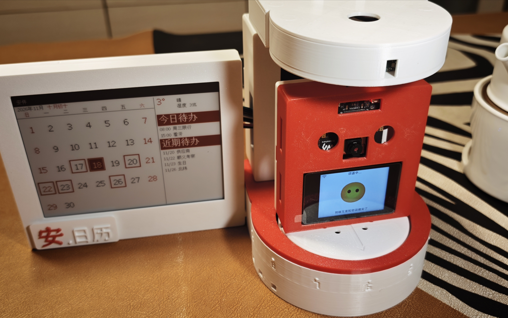
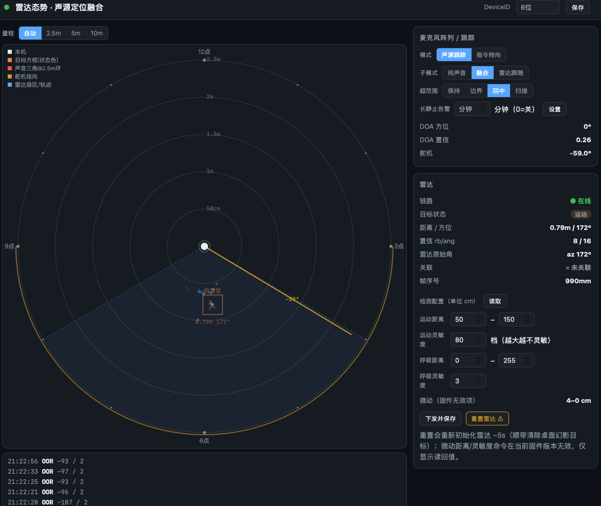

# ESP32-S3 SuperMini × 3DMIC-291 × 60GHz 毫米波雷达：声源定位 + 运动感知融合

在声源定位跟踪系统（继承 [ESP32_S3_CAM_Mic3_PMW1](https://github.com/art-jin/ESP32_S3_CAM_Mic3_PMW1) v2.6）基础上接入 **MS60-1211S80M 60GHz 毫米波雷达**（MoreSense，AT6010 SoC），实现：

- **声源-目标关联**：说话时自动判断声音是否来自雷达检测到的人/物，关联结果（方位差、距离）作为元数据输出
- **声音关联门**（默认关）：开启后只有与雷达目标方位吻合的声音才驱动舵机——挡住机器人/音响等持续声源对指向的抢占
- **三种跟踪子模式**（REST 可切换，NVS 持久化）：`audio_only`（默认，纯声音）/ `fusion`（声音优先，静默 3 秒后雷达跟随）/ `radar_follow`（仅雷达驱动）
- **超范围策略**：目标超出舵机 9点~3点（±90°）时 `hold`（默认）/ `clamp` / `home` / `scan` 四选一
- **场景事件流**：目标进入/离开、声源关联、雷达离线/恢复、超范围、长静止看护告警——`/api/events` 增量轮询
- **摔倒疑似检测**（默认开）：躺平人体在雷达数据流里呈"躯干/脚部"双峰距离振荡（散布 ≥50cm），检测器据此输出 `FALL_SUSPECT`/`FALL_CLEAR`；页面同步显示"躺"姿态徽标
- **雷达自动恢复**：模块假死/波特率回退时自动重跑上电序列（含波特率自愈），无需人工干预
- **老人居家监控场景**：麦克风（360° 听觉）+ 雷达（±60° 运动/呼吸感知）互补，舵机指向跟上场景事件

## 实物

安伴机器人"安安"——本板作为其"脖子"：3DMic 阵列负责**寻声**（声音来自哪个方向），60GHz 毫米波雷达负责**寻人**（人在哪个方位、多远），舵机驱动整块 CAM 机身**转向**目标。三者在同一块 ESP32-S3 上融合：说话时跟声、静默时跟人、人靠近时转头看人。



## 页面预览

设备内置可视化页面（浏览器打开 `http://esp32-mic-<MAC4>.local/`，右上角填 DeviceID）：



左侧态势图：距离环（量程可选）、4~8点雷达扇区、±90° 舵机弧与指向针、状态色目标方框（躺时叠加 🛌 徽标）、8 秒轨迹尾迹、实验性多目标跟踪（推断 ID）、2.5m 语音环上的声音三角；右侧：跟踪控制（模式/子模式/超范围/长静止/声音关联门/指向/摇动）、跌倒线索开关与状态、雷达配置（读取/下发保存/重置）。

## 硬件

| 部件 | 说明 |
|---|---|
| 主控 | ESP32-S3 SuperMini（`BOARD_ESP32_S3_SUPERMINI`，注意丝印 +2 偏移）|
| 麦克风 | 3DMIC-291 三麦 MEMS 阵列，固定安装（CLK0=3/DAT0=4/CLK1=5/DAT1=6）|
| 雷达 | MS60-1211S80M，UART **115200** 8N1（TX→GPIO9，RX→GPIO8，OUT1→GPIO11）|
| 舵机 | MG90S 直驱 1:1（GPIO7），软件限位 ±90°，方向反转 |

### 感知覆盖（雷达正对被监测区，即 6 点方向）

```
 9点      10点           12点           2点      3点   ← 12点方向（背面）
  ├─────────└──── 雷达视野 ±60° ────┘─────────┤
  └──────────── 舵机可达 ±90° ────────────────┘
  └──────────────── 麦克风 DOA 360° ──────────┴── 3~9点后半圈仅事件上报
             ↑ 6点方向（雷达法线 / 舵机 home / 被监控人）
```

## 快速开始

```bash
# ESP-IDF v6.0.1
cp main/wifi_creds.h.example main/wifi_creds.h   # 填 WiFi SSID/密码
. $IDF_PATH/export.sh
idf.py build
idf.py -p /dev/cu.usbmodemXXXX flash monitor     # Ctrl-] 退出
```

上电后舵机自检扫动（±80°），随后进入声源跟踪。WiFi 连接后通过 mDNS 访问 `http://esp32-mic-<MAC4>.local`；DeviceID 从串口日志读取（6 位，REST 鉴权用）。

## REST API 摘要（完整规格见 [API.md](API.md)）

| 方法 | 路径 | 说明 |
|---|---|---|
| GET | **/** | 内置可视化页面（态势图 + 控制，无需鉴权） |
| GET | /api/ping | 心跳（免鉴权） |
| GET | /api/status | 完整状态：DOA + 舵机 + 雷达目标 + 关联结果 + 跌倒状态 + 姿态散布 |
| GET | /api/events?since=SEQ | 场景事件队列（32 槽，序号增量拉取） |
| GET/POST | /api/radar | 雷达配置读回 / 下发（距离/灵敏度/保存，US-010） |
| POST | /api/radar/reset | 雷达复位（清幻影，后台 ~5s） |
| GET | /api/logs | NVS 事件日志（重启留存，取证用） |
| POST | /api/mode | track/command；submode/oor/still_min/assoc_gate/fall_detect |
| POST | /api/point | 指令转向（command 模式） |
| POST | /api/shake | 摇动舵机（command 模式） |

```bash
# 例：切到融合模式 + 开启 30 分钟长静止告警
curl -X POST "http://esp32-mic-XXXX.local/api/mode?device_id=XXXXXX" \
     -d '{"submode":"fusion","still_min":30}'
# 拉取新事件
curl "http://esp32-mic-XXXX.local/api/events?device_id=XXXXXX&since=42"
```

## 雷达协议实测要点（详见 `tasks/radar-protocol-notes.md`）

- 模组固件默认 **115200**（AT6010 文档写的 921600 不适用）；命令帧 0x58/回复 0x59，校验和为 u16 小端求和
- **主动上报（0x5A）不可用**——唯一数据源是 0x30 轮询（5Hz），返回**单个聚合目标**（fmcw_det_info_t：det_result/range/angle/conf/frame_idx）
- 无目标签名：det_result=0, range=0, conf=0；`velo` 恒 0（固件预留）
- 角度→钟点方位：`az = 187° + 2.1 × angle`（三点标定，残差 ±4°；斜率 ≈1/sin30°，固件输出正弦压缩角）
- 静态桌面幻影（呼吸@~64cm 假目标）：驱动在 init 时 save+System Reset 清除；桌面多反射体场景约 5 分钟后可能复发
- 模块有假死（静默不响应）与波特率回退（921600）两种失效形态：驱动含波特率自愈 + 离线 15s 自动重跑上电序列
- 运动检测出厂最远仅 1.5m（页面/REST 可调至 10m）；呼吸检测上限 2.55m 固件写死
- 躺平签名 = 双峰距离振荡（躯干呼吸簇 + 脚部运动簇，散布 0.6~1.1m）——摔倒检测与"躺"姿态显示的数据基础

## 实测状态

| 项 | 日期 | 结果 |
|---|---|---|
| 声源-目标关联（T3） | 09-02 | 6点说话 diff 11°/4° 关联 ✓；视野外 diff 77° 正确不关联 ✓ |
| 偏航校准（T2） | 09-02 | 三点拟合残差 ±4° ✓ |
| 目标出现/消失/离线/恢复（T1/T8） | 09-02 | 全部正确，离线 600ms 内检出 ✓ |
| 雷达静默跟随 + 声音优先（T4） | 09-02 | 舵机随人移动，说话即接管 ✓ |
| 事件队列（T7） | 09-02 | seq/next/since 增量正确，关联事件去抖限频 ✓ |
| 长静止告警 | 09-02 | ALARM 触发 + 说话恢复 ✓；反抖动修复待长跑复测 |
| 超范围策略（T5） | 09-02 | REST/NVS/逻辑已验证；物理站位不可达，实体行为待补测 |
| 可视化页面 V1/V2 | 09-02 | 态势图/控制/雷达配置台架实测 ✓；多目标跟踪（推断 ID）默认关 |
| 声音关联门 | 09-03 | REST/NVS ✓；实体机器人验证待雷达恢复后补 |
| 雷达假死自动恢复 | 09-03/07 | 两次真实假死事件，波特率自愈 + 上电序列自恢复验证 ✓ |
| 摔倒疑似检测 v3.1 | 09-09 | 倒地→4s 触发→趴地 30s 保持→起身 6s 清除，全链路 ✓（雷达高 116cm、人 170cm、趴倒 @1.2m）；走动/坐下排除 ✓ |
| 回归/稳定性（T9/T10） | — | 待 24h 长跑 |

## 代码结构

```
main/
├── main.c           应用装配：mic 任务 → DOA → tracker → radar/fusion
├── mic_capture / doa     I²S PDM 采集 + GCC-PHAT 三麦定位（继承）
├── servo / tracker       舵机驱动 + 跟踪决策（子模式/OOR 策略/关联门/command_target 共享路径）
├── radar.{c,h}      雷达驱动：5Hz 轮询、单目标状态、中值滤波、方位映射、离线检测与自愈、
│                    静止告警、摔倒疑似检测（双峰振荡）、配置命令邮箱
├── fusion.{c,h}     声源-目标关联（20° 门限 + 翻转去抖 + 限频）
├── events.{c,h}     场景事件环形队列（RAM 32 槽 + evlog 镜像）
├── mode_manager     track/command + 子模式/超范围/告警阈值/关联门/跌倒开关（NVS）
├── rest_api / status / wifi / evlog    REST 服务（继承 + 新端点）
├── index.html       内置可视化页面（EMBED_FILES 编入固件，GET / 服务）
└── radar_probe.{c,h}    协议探针固件（RADAR_PROBE_MODE=1 启用，调试用）
tools/capture.py         台架采集（倒计时/计时器/实时过滤，日志 /tmp/capture_last.log）
```

## 文档索引

- `ArthurReadMe.md` — 原始需求（雷达接线、场景目标；本地文件）
- `tasks/prd-radar-audio-fusion.md` — PRD：用户故事 / 功能需求 / 测试矩阵 / 开发计划
- `tasks/radar-protocol-notes.md` — 雷达协议实测笔记（波特率、帧格式、幻影、标定、告警/摔倒检测教训与常数）
- `tasks/visualizer-design.md` — 可视化页面设计（布局/元素/端点映射/分期）
- `CLAUDE.md` — 工程指南（构建/烧录/架构约定）
- 基础项目完整文档：上游仓库 [ESP32_S3_CAM_Mic3_PMW1](https://github.com/art-jin/ESP32_S3_CAM_Mic3_PMW1)

## 已知限制

- 麦克风 DOA 在 >1.5m 语音 3-mic 产出率骤降（10mm 阵列间距的物理限制）——远场以雷达角度为主、DOA 事件为触发
- 雷达固件仅暴露单聚合目标，多目标场景报告"最显著"目标；页面"多目标跟踪"为软件推断 ID（实验性，默认关），靠近/交叉会跟混，幻影反射体同样成轨
- **坐与站无法区分**（坐姿重心高 ≈ 设备安装高度，斜距差 <10cm）——页面姿态只显示"躺/直立"两档，不做坐/站声明
- **摔倒检测是"疑似线索"不是确定判定**：无高度通道，靠距离双峰启发式。桌面/工作台场景（俯身起身）假阳性偏高；**床头部署时正常上床睡觉也会触发**（床躺与地躺距离簇重叠）——床区抑制（摆放语义/区域引擎）已规划未实现，现阶段床头试运行建议关闭 fall_detect 或接受就寝时的询问
- 桌面/多反射体环境下静止告警事实上关闭（持续手部/幻影运动）；目标部署场景为椅子/床边单人
- **⚠ 家有宠物时长静止告警会失效（假阴性）**：雷达固件只报最显著目标，宠物活动会持续被判为"有人活动"——老人倒地而宠物走动时告警被抑制。缓解：调低运动灵敏度（压制小反射体）、雷达上仰 15~20°（排除地面层）。有宠物的家庭应以事件流+页面观察为主、still_min 告警为辅。根治需固件级多目标/高度通道（本固件不可用）
- 呼吸（静止人体）检测距离上限 2.55m（固件写死，0x39 命令无效）；运动检测可配至 10m（页面可调）
- T9 回归与 T10 24h 稳定性长跑待执行；T5 超范围实体补测待物理条件

## 更新记录（按日索引）

最近 14 个有提交的日期（自动汇总自 git log；点 commit 看变更，"当日全部"跳 GitHub 当日历史）：

**2026-11-27**（5 commits）
- [7ab4f42](https://github.com/art-jin/ESP32_S3_CAM_Mic3_RD60_PMW1/commit/7ab4f42) 98-S1 脖子: 跌倒几何先验(2026112712) — 近距门控+高度归一
- [6ddfbc0](https://github.com/art-jin/ESP32_S3_CAM_Mic3_RD60_PMW1/commit/6ddfbc0) 11-27 根修: identity_is_provisioned 用生效值判(OTA 热重启进 PAIRING 回归) + cmd/ota target 分拣
- [ad82e00](https://github.com/art-jin/ESP32_S3_CAM_Mic3_RD60_PMW1/commit/ad82e00) 态势页布局改 flex 撑满(2026112708): Safari 短屏 vh 压扁 canvas 实录 1006×370
- [5d0ed21](https://github.com/art-jin/ESP32_S3_CAM_Mic3_RD60_PMW1/commit/5d0ed21) 态势页 Safari 兼容(2026112707): canvas 用 min(100%,vh) 养正方形, 修 aspect-ratio+max-height 被压扁致目标框画出画布
- [76489b8](https://github.com/art-jin/ESP32_S3_CAM_Mic3_RD60_PMW1/commit/76489b8) 态势页禁缓存(2026112706): Safari 激进缓存旧版致狂徒代码不出现, 加 no-store 头

**2026-11-26**（10 commits）
- [6bdbeed](https://github.com/art-jin/ESP32_S3_CAM_Mic3_RD60_PMW1/commit/6bdbeed) 97-S1: wake_cfg 回执加 evlog(0=applied/9=receipt fail)
- [9dd0a38](https://github.com/art-jin/ESP32_S3_CAM_Mic3_RD60_PMW1/commit/9dd0a38) 97-S1 脖子: 雷达直驱转向(2026112705) — 本地反射, 不等 CAM 批准
- [2cc55a2](https://github.com/art-jin/ESP32_S3_CAM_Mic3_RD60_PMW1/commit/2cc55a2) zone_tracker 去抖衰减(2026112704): 斜前方走近多径鬼影致 presence 失效
- [7e53beb](https://github.com/art-jin/ESP32_S3_CAM_Mic3_RD60_PMW1/commit/7e53beb) 态势页平滑加强: 9 帧中值+EMA α=0.35(2026112703)
- [a03545d](https://github.com/art-jin/ESP32_S3_CAM_Mic3_RD60_PMW1/commit/a03545d) 态势页显示层平滑: 5 帧中值+鬼影抑制(2026112702)
- [840d5c4](https://github.com/art-jin/ESP32_S3_CAM_Mic3_RD60_PMW1/commit/840d5c4) 96-S1 裁决 C(11-27): 开机默认指令态, 跟踪为对话期专属(2026112701)
- …另 4 个提交（[当日全部](https://github.com/art-jin/ESP32_S3_CAM_Mic3_RD60_PMW1/commits?since=2026-11-26&until=2026-11-26)）

**2026-11-24**（1 commits）
- [80e478c](https://github.com/art-jin/ESP32_S3_CAM_Mic3_RD60_PMW1/commit/80e478c) 95-A/S1 脖子侧: 空身份起配对 softAP(2026112401)

**2026-11-23**（5 commits）
- [c098cbb](https://github.com/art-jin/ESP32_S3_CAM_Mic3_RD60_PMW1/commit/c098cbb) R27-S1 cmd/point 下行: MQTT one-shot 转向(92 §5.1) — 2026112306
- [b67beb6](https://github.com/art-jin/ESP32_S3_CAM_Mic3_RD60_PMW1/commit/b67beb6) R25-P1 躺地状态机(三轮迭代): ①fall_feed 内检测→radar_task 主循环(AT6010 无目标不发帧,fall_feed 不可达) ②目标丢失清除 10s→95s(防抢跑 lying 90s) ③events.c AEVT_LYING_SUSPECT 独立 case(原与 FALL_CLEAR 共享=错发 fall_clear); 离线待验证: lying_suspect 未到 broker(需串口确认固件侧行为)
- [11cdac4](https://github.com/art-jin/ESP32_S3_CAM_Mic3_RD60_PMW1/commit/11cdac4) R25-P1 固件侧: 躺地状态机 — fall_suspect 后目标 absent 或 <500mm 持续 90s → lying_suspect 事件(absent=最强倒地信号/低距离=可见但地面高度); 正常恢复(>800mm)重置计时; 2026112302 双板 OTA
- [01ce2b9](https://github.com/art-jin/ESP32_S3_CAM_Mic3_RD60_PMW1/commit/01ce2b9) R25 遥测闸: feat+absent 两条流均挂 fall_shadow 门(标定模式=开/正常=零流量); 系数定型后 10k 行/天→0; 2214 双板 OTA
- [3b547ae](https://github.com/art-jin/ESP32_S3_CAM_Mic3_RD60_PMW1/commit/3b547ae) 存活案终破: ota_publish 把 strlen 当 qos 传(原始死码一脉相承)→mosquitto Invalid QoS 踢线=三连复现的连接刚建即死; 一行修(qos=1,retain=0); 2212 实证首连零 EOF+PUBACK 120ms+boot_pending_verify→boot_confirmed 全遥测首次无缺口; 附 1s settle 延迟(CONNACK 竞态保险)

**2026-11-22**（3 commits）
- [c505780](https://github.com/art-jin/ESP32_S3_CAM_Mic3_RD60_PMW1/commit/c505780) 回滚案侦结: 机制实证通过(2209 未确认→复位→自动回退 2207)! 根因=第二条 otadata 空时 ABORTED 触发 both-invalid 恢复路径反祝福当前镜像; 坑册=bootloader 子工程 config 变更不重生成(须清 build/bootloader); mark ESP_FAIL 待查项
- [1703863](https://github.com/art-jin/ESP32_S3_CAM_Mic3_RD60_PMW1/commit/1703863) 回滚演练收尾: mark_valid 还原+2207 OTA 健康态(boot_confirmed 云端实证); 开放项=bootloader 自动回退未触发(PENDING_VERIFY 在但复位后未回滚旧槽, 明日对照 IDF 文档专攻)
- [ef22700](https://github.com/art-jin/ESP32_S3_CAM_Mic3_RD60_PMW1/commit/ef22700) R26-B/C/D 完成并首 OTA 实证: esp_https_ota 内核+cmd/ota dispatch(版本闸/force/域白名单)+rollback(PENDING_VERIFY→首连 mark_valid)+mDNS 身份派生+online 发布加固(PUBACK 记账+重试); 破两陈案: s_topic_ota 自 11-11 起 snprintf 缺失(空串订阅=OTA 通道死)+blank bss 38.9KB 挤爆内部 DRAM(TLS -0x3000); 帧缓冲显式 PSRAM; CONNECTED 全操作收单任务串行. greywolf USB→OTA 2026112205 全链 15s/1.5MB; ROLLBACK_ENABLE 入 sdkconfig.defaults

**2026-11-21**（3 commits）
- [f9bb540](https://github.com/art-jin/ESP32_S3_CAM_Mic3_RD60_PMW1/commit/f9bb540) R26-A 切片收尾: identity epd_panel NVS 键(读/单键写+回读)+REST 注入字段+app init 接 epd_geom_set; cfg_channel epd_panel 下发(同值幂等/异值回执先发 1.5s 自重启); plane bench 端点/工具运行时门控; board_config EPD_PANEL_* 退役; wait_release 孤儿清理; 固件 0 警告+harness 三检回归绿
- [be79a9b](https://github.com/art-jin/ESP32_S3_CAM_Mic3_RD60_PMW1/commit/be79a9b) R26-A3 主体: 删宏编译报名(51 处/5 文件)+运行时几何(epd_geom 表+_Static_assert+host env 注入); epd.c 双驱动合并运行时分派(_5/_42 后缀)+遗留 SSD1683 段删除(-125 行); 固件构建绿; 主机等价性实证: 重构前后双面板渲染平面字节一致(harness cmp)
- [f816d93](https://github.com/art-jin/ESP32_S3_CAM_Mic3_RD60_PMW1/commit/f816d93) ㉑② 偏好主页: ttl>=86400 的 dash 登记当日常驻, 临时页 TTL 到期回退偏好页而非硬编码月历(NVS home 三键+replay 原日戳); epd_display_planes 5.83-only 条件编译(4.2 换板链接实录); greywolf4.2/anan5.83 双板烧录验收

**2026-11-20**（6 commits）
- [cc4b3e4](https://github.com/art-jin/ESP32_S3_CAM_Mic3_RD60_PMW1/commit/cc4b3e4) R25-P1 前置: absent 遥测 — 无目标时段也 10s 一报(丢失→重建签名数据)
- [0f1cdb5](https://github.com/art-jin/ESP32_S3_CAM_Mic3_RD60_PMW1/commit/0f1cdb5) R25-P0 数据日志+影子模式 — 3-7 天系数采集期开启(79 ⑰)
- [a66aec5](https://github.com/art-jin/ESP32_S3_CAM_Mic3_RD60_PMW1/commit/a66aec5) identity 注入重启前延 500→1000ms — 与 CAM 仓同步(响应偶发被截断实录)
- [c3e23da](https://github.com/art-jin/ESP32_S3_CAM_Mic3_RD60_PMW1/commit/c3e23da) F-1b 脖子 NVS 身份 — identity.c/h + /api/identity_config(写后回读校验)
- [053a639](https://github.com/art-jin/ESP32_S3_CAM_Mic3_RD60_PMW1/commit/053a639) R25 90a 复审收尾 — SUSPECT s_fa 补哨兵门控+fall_fire 用滤波角+feat(-) 加 ring 填充数
- [c92d2f0](https://github.com/art-jin/ESP32_S3_CAM_Mic3_RD60_PMW1/commit/c92d2f0) R25-P0 90a 评审修正 — P0 角度单位(50→6°)+P1-1 crossings 去抖 20Hz 语义+P1-2 angle_conf 门控+P1-3 负样本遥测+P2-1 offline 容忍

**2026-11-19**（3 commits）
- [602acef](https://github.com/art-jin/ESP32_S3_CAM_Mic3_RD60_PMW1/commit/602acef) R25-P0: 自适应散布阈值 + 角度方差投票(OR 非AND) + 影子日志 — 3.3m 坐姿不再触发跌倒
- [9e21730](https://github.com/art-jin/ESP32_S3_CAM_Mic3_RD60_PMW1/commit/9e21730) 雷达轮询 5→20Hz + frame_idx — RAD_POLL_MS 200→50, FALL_WIN_N 20→80(保持 4s 窗口); 模块内部 43Hz 充裕
- [d956868](https://github.com/art-jin/ESP32_S3_CAM_Mic3_RD60_PMW1/commit/d956868) /api/status 加 frame_idx — 帧率实测基础设施(R25 前置); 实测雷达内部 41Hz/固件轮询 5Hz

**2026-11-18**（5 commits）
- [c55dc6d](https://github.com/art-jin/ESP32_S3_CAM_Mic3_RD60_PMW1/commit/c55dc6d) MQTT buffer.size 1024→4096 — dash 载荷 ~993B 被 1024 默认值截断(丢尾部 }=bad json)
- [39df49d](https://github.com/art-jin/ESP32_S3_CAM_Mic3_RD60_PMW1/commit/39df49d) 5.83 吋复合 dashboard (74 §7.2) — 左栏月历+右栏天气/待办, 新增 DMODE_DASH 模式
- [4f89619](https://github.com/art-jin/ESP32_S3_CAM_Mic3_RD60_PMW1/commit/4f89619) 5.83 吋状态页适配 — 卡片标签/数值 2x(32px)+垂直偏移比例化填充大卡片
- [a76a3e2](https://github.com/art-jin/ESP32_S3_CAM_Mic3_RD60_PMW1/commit/a76a3e2) 5.83 吋 P1 适配: 药格标签 2x 字号 + 待办表回退 1x 保持多行优势(用户裁决)
- [0eef4fb](https://github.com/art-jin/ESP32_S3_CAM_Mic3_RD60_PMW1/commit/0eef4fb) 5.83 吋 P0 适配: 天气页比例化布局+消息页垂直居中+全行 2x 字号

**2026-11-17**（1 commits）
- [4f83a46](https://github.com/art-jin/ESP32_S3_CAM_Mic3_RD60_PMW1/commit/4f83a46) 5.83吋新屏上脖(MENGOR)当日点亮 — 根因=epd.h 几何分裂 + UC8179-V2 协议移植

**2026-11-11**（1 commits）
- [95131b7](https://github.com/art-jin/ESP32_S3_CAM_Mic3_RD60_PMW1/commit/95131b7) OTA P1.5 脖子板 — 分区表双槽+OTA 客户端+cmd/ota handler+端到端验证

**2026-11-09**（1 commits）
- [5104b10](https://github.com/art-jin/ESP32_S3_CAM_Mic3_RD60_PMW1/commit/5104b10) R2 屏持久化端侧 — NVS 缓存当前页+overlay 暂存,开机重放(78 §4.4/74 M1.5)

**2026-11-05**（2 commits）
- [fb248ed](https://github.com/art-jin/ESP32_S3_CAM_Mic3_RD60_PMW1/commit/fb248ed) 修复月历页文字锚点残留(anan 实录"年月农历掉页底 30 下一行") + 新增 /api/epd/frame 帧转储端点
- [acf4d65](https://github.com/art-jin/ESP32_S3_CAM_Mic3_RD60_PMW1/commit/acf4d65) 5.83 结案(本体故障 RAM 不保持写入) + 台架回 4.2 — 5.83 分支留"备好待新屏"形态

**2026-11-04**（2 commits）
- [ada4cb9](https://github.com/art-jin/ESP32_S3_CAM_Mic3_RD60_PMW1/commit/ada4cb9) 安安 4.2 吋点亮(P420016-MF1-A 价签拆机屏): BUSY 反极性+红平面取反+每帧 reinit — 脖子全功能
- [3202c8c](https://github.com/art-jin/ESP32_S3_CAM_Mic3_RD60_PMW1/commit/3202c8c) anan(安安)第4台脖子上线: 5.83吋 P0/P2 + PSRAM 启用 + 开脖 SOP (docs/48 §15 2026-11-04)

> 完整历史见 [GitHub Commits](https://github.com/art-jin/ESP32_S3_CAM_Mic3_RD60_PMW1/commits/main)。

## License

Apache-2.0（见 [LICENSE](LICENSE)）
